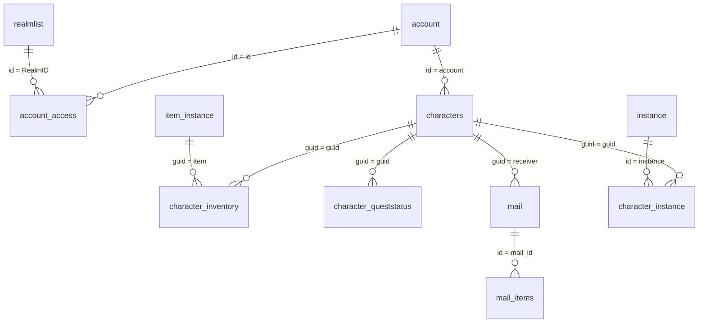

# ERD

## When to use

Before designing content or a schema change, or when a relationship is unclear.

## Note

AzerothCore has very few real foreign-key constraints: the live databases contain only a handful.
Most relationships are conventions enforced by the loader, not FKs. This ERD is curated from the
loader code and table names; it is not auto-discovered.

## Core content graph

```mermaid
erDiagram
    creature_template ||--o{ creature : "entry = id1"
    creature_template ||--o{ creature_template_model : "entry = CreatureID"
    creature ||--o| creature_addon : "guid = guid"
    creature_template ||--o{ creature_queststarter : "entry = id"
    creature_template ||--o{ creature_questender : "entry = id"
    quest_template ||--o{ creature_queststarter : "ID = quest"
    quest_template ||--o{ creature_questender : "ID = quest"
    quest_template ||--|| quest_template_addon : "ID = ID"
    quest_template ||--o{ quest_details : "ID = ID"
    creature_template ||--o{ npc_vendor : "entry = entry"
    item_template ||--o{ npc_vendor : "entry = item"
    creature_template ||--o| gossip_menu : "gossip_menu_id = MenuID"
    gossip_menu ||--o| npc_text : "TextID = ID"
    gameobject_template ||--o{ gameobject : "entry = id1"
    gameobject_template ||--o{ gameobject_loot_template : "Data1 = Entry"
    creature_template ||--o{ creature_loot_template : "lootid = Entry"
    item_template ||--o{ creature_loot_template : "entry = Item"
    creature_template ||--o{ smart_scripts : "entry = entryorguid"
    instance_template ||--o{ instance_encounters : "map = map"
    spell_dbc ||--o{ spell_script_names : "ID = spell_id"
    map_dbc ||--o{ instance_template : "ID = map"
```

## Auth and characters

## How to read it

- `A ||--o{ B` means one A relates to many B rows.
- The label is the join condition.
- A dashed relationship means optional or loader-dependent.
- The loader is the source of truth: `ObjectMgr`, `QuestMgr`, `LootMgr`, `InstanceScript`.

## Known high-risk joins

- `creature.id1` and `creature.guid` are different keys; never mix them.
- `quest_template.ID` is used by several tables; a missing addon row changes behavior.
- `smart_scripts.entryorguid` is positive for a template and negative for a spawn.
- `conditions` has no FK; a wrong `SourceTypeOrReferenceId` silently does nothing.
- `instance_encounters` drives boss credit; a wrong entry leaves the instance incomplete.

## References

- [schema-guide.md](schema-guide.md)
- [specs/database.md](../../specs/database.md)
- `src/server/game/Globals/ObjectMgr.cpp`
- `src/server/game/Quests/QuestDef.cpp`
- `src/server/game/Loot/LootMgr.cpp`
